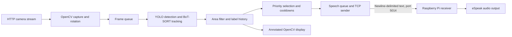

# SMART VIEW AI

**Computer vision for assistive audio guidance — university graduation project**

SMART VIEW AI investigates how object detection can be translated into selective spoken descriptions for people with visual impairments. Its central engineering focus is deciding **which object to announce, when to announce it, and how to avoid repeated alerts**, rather than reading every detection aloud.

The repository brings together the original Python processing application, a Raspberry Pi audio receiver, a graduation presentation, demonstration recordings, and prototype images. It documents a research and engineering prototype; the materials do not establish a validated navigation aid or independent mobility solution.

[Project presentation](smartview%20ai%20v4%20final.pptx) · [Demo 1](videos/demo_1.mp4) · [Demo 2](videos/demo_2.mp4) · [Processing code](main.py) · [Raspberry Pi code](raspberry_pi.py)

## Objectives

- Convert camera observations into concise object-and-direction phrases, such as “person on the right.”
- Reduce competing announcements using semantic priority classes and bounding-box area filtering.
- Use tracking IDs and temporal label accumulation to suppress repeated announcements.
- Separate vision processing from speech playback through a local-network Raspberry Pi audio node.
- Explore currency recognition and a smart cane form factor as extensions, with their evidence and limitations documented separately.

## Implementation status

| Component | Status and evidence |
| --- | --- |
| General object detection and tracking | Implemented in `main.py`; a supplied screenshot shows person/chair labels, IDs, zones, and area filtering. |
| Priority selection and speech suppression | Implemented in source; no comparative user study or quantitative reduction in alerts is provided. |
| Raspberry Pi audio delivery | TCP sender and eSpeak receiver are implemented; no controlled end-to-end hardware validation report is included. |
| Money detection | Experimental. A mode and model-loading path exist, and an image shows a banknote detection. Custom weights, training data, and evaluation results are absent. |
| Smart cane | A physical prototype is pictured. Sensor wiring, firmware, and integrated testing are not documented in the repository. |
| Ultrasonic sensing | An intended cane-related capability whose implementation is not verified by the supplied source, slides, or image. |
| Mobile deployment, reading, smart glasses, haptics, offline operation | Future directions in the presentation. A phone interface appears in the videos, but its source and integration are not included in the supplied Python implementation. |

## System architecture



The processing computer captures an HTTP video stream and rotates each frame 90° clockwise. Separate camera, inference, and network threads communicate through queues of size one. The camera replaces queued frames when necessary, while inference processes every third frame it dequeues. These choices limit queued work; they do not establish a guaranteed frame rate or latency.

PyTorch selects CUDA when available and otherwise uses the CPU. The graphical loop displays annotated results and accepts mode-switching keys. Vision inference runs on the processing computer; `raspberry_pi.py` performs speech playback rather than YOLO inference.

## Key technical contributions

These are application-level integration and decision-policy contributions built on existing YOLO and BoT-SORT components. The repository does not claim a new detector or tracking algorithm.

### 1. Priority Classes

The code selects one eligible target per inference result using the following dictionary:

| Priority | Labels configured in the source |
| --- | --- |
| 1 | `person`, `car`, `motorcycle`, `bus`, `truck`, `bicycle`, `stop sign`, `traffic light`, `fire hydrant` |
| 2 | `chair`, `couch`, `bed`, `dining table`, `bench`, `door` |
| 3 | Any other detected label |

Lower numbers take precedence; equal-priority candidates are compared by bounding-box area, favoring the larger box. Money mode assigns all candidates priority 1. Priority labels are configuration entries: adding `door` to the dictionary does not make the loaded general model capable of detecting doors.

### 2. Object Filtering

Both modes use a confidence threshold of **0.60**. General mode uses `imgsz=160` and an area threshold of **18,000 pixels²**; money mode uses `imgsz=480` and **4,000 pixels²**. These are configured parameters, not measured performance results. Area is computed from box coordinates in the captured frame.

Boxes below the area threshold remain visible with a white outline and a “Too Far” label but are excluded from spoken-target selection. This is an image-area heuristic: apparent size depends on object dimensions, framing, and camera geometry. It is **not a calibrated distance measurement** and is separate from ultrasonic ranging.

### 3. ID Tracking and temporal speech control

Ultralytics tracking uses `persist=True` with `botsort.yaml`. The application maintains label counts per tracking ID and selects the most frequently observed label for that ID. An object becomes eligible after that label accumulates at least **five qualifying observations**; these need not be consecutive frames.

Once a phrase is enqueued, the track is marked as spoken. A class-level cooldown suppresses the same label for **five seconds**, while a global speech interval of **3.5 seconds** separates enqueued phrases. Track history expires after five seconds without a qualifying observation, and application history is cleared on a mode change. These mechanisms aim to reduce repetition; tracking errors and reidentification can still lead to repeated alerts. Enqueueing a phrase does not confirm successful delivery or audible playback.

## YOLO detection and audio guidance

General mode loads `yolov8x.pt` using Ultralytics. YOLO produces object boxes and class labels, while the tracker associates detections across frames. The application compares each box center with the image midpoint to generate “left” or “right.” This is a two-zone image description, not route planning, depth estimation, or collision prediction.

The network thread sends the selected phrase followed by a newline. On the Raspberry Pi, the receiver accumulates partial TCP packets, extracts complete lines, and invokes:

```text
espeak -s 150 -g 10 <received phrase>
```

The Pi listens on all interfaces on TCP port `5014` and handles one client at a time. Speech execution is synchronous. The client makes one initial connection attempt and does not automatically reconnect. The protocol has no authentication, encryption, delivery acknowledgement, or audio-completion feedback; use a trusted local network.

## Observed results

### General detection screenshot


The supplied screenshot shows a person and chair with tracking IDs, accumulated label counts, the center line, and a white “Too Far” box. It supports the presence of visual detection and filtering output for this scene. Its instantaneous FPS overlay is not a benchmark, average throughput, or end-to-end latency measurement. A still image cannot establish ID stability over time, speech quality, or safe navigation.

### Experimental Money Detection


The image shows the application in money mode with a box around a US twenty-dollar banknote. The presentation describes a separate custom YOLO model developed using Roboflow. The code attempts to load `best.pt`, but the repository does not contain those weights, the dataset, training configuration, class list, or held-out evaluation.

Money Detection is therefore an **experimental feature, not a fully deployed currency recognition system**. The example does not establish accuracy across denominations, currencies, lighting, or viewing angles. If `best.pt` fails to load, the code silently substitutes the general model after printing an error; selecting money mode alone does not prove custom recognition is active. The source uses the same class-and-direction phrase template in both modes rather than a separate currency speech formatter.

## Smart cane prototype and ultrasonic sensing


The photograph documents a physical cane prototype being handled indoors with a phone. It does not establish the sensor model, circuitry, measurement accuracy, or connection to the vision/audio pipeline.

An ultrasonic sensor can estimate range by transmitting a pulse and measuring the echo's round-trip travel time. Such ranging could complement camera-based semantic recognition, but neither supplied Python application reads GPIO or ultrasonic measurements. No sensor firmware, wiring diagram, trigger distance, or obstacle-alert mapping is provided. Ultrasonic integration and cane-to-processing-unit feedback remain **unverified in the available implementation**. The image-area filter should not be described as ultrasonic distance sensing.

## Project Demonstration

- [Watch Demo 1](videos/demo_1.mp4)
- [Watch Demo 2](videos/demo_2.mp4)

Both original MP4 files are preserved. Sampled frames show a phone interface and camera imagery; interface controls alone do not verify working reading, currency recognition, offline inference, or integration with the supplied Python programs. These recordings are qualitative project materials rather than controlled experiments.

## Technologies and dependencies

| Technology | Use |
| --- | --- |
| Python | Processing application and Pi audio receiver |
| OpenCV (`opencv-python`) | HTTP camera capture, rotation, annotation, graphical display |
| PyTorch (`torch`) | CPU/CUDA inference support |
| Ultralytics (`ultralytics`) | YOLO model loading and tracking API |
| BoT-SORT | Tracking through Ultralytics' `botsort.yaml` configuration |
| TCP sockets, threading, queues | Standard-library networking and concurrency |
| Raspberry Pi and eSpeak | Remote text-to-speech playback |
| Thonny | Development/run environment for the Pi application; not a runtime dependency |
| Roboflow | Custom currency-model development tool reported in the presentation; training artifacts are not included |

The third-party Python imports are listed in [requirements.txt](requirements.txt). The Pi receiver uses only `socket` and `subprocess` from the standard library, plus the external eSpeak executable. Original package and Python versions were not supplied, so dependencies are unpinned. Some Ultralytics versions may require additional tracking dependencies at runtime.

## Installation and operation

### Processing computer

Use a Python version supported by the installed PyTorch, Ultralytics, and OpenCV releases. A graphical desktop is required for `cv2.imshow`.

```bash
git clone https://github.com/omarsaadeh/SMART-VIEW-AI.git
cd SMART-VIEW-AI
python3 -m venv .venv
source .venv/bin/activate
python -m pip install -r requirements.txt
```

On Windows, activate with `.venv\Scripts\activate`. For CUDA, follow the official PyTorch installation instructions for a build compatible with the local GPU and drivers. CPU fallback is implemented, but throughput is hardware-dependent.

Run from the repository root. Supply `yolov8x.pt` there, or allow Ultralytics to download it. To reproduce the currency experiment, obtain the original custom `best.pt` separately; a general YOLO model is not a replacement for those weights. Model files are excluded by `.gitignore`.

### Raspberry Pi audio node

On Raspberry Pi OS, install eSpeak and configure a working audio output:

```bash
sudo apt update
sudo apt install espeak
python3 raspberry_pi.py
```

Alternatively, open `raspberry_pi.py` in Thonny and run it on the Pi. The computer's vision dependencies are not required for this audio-only script.

### Network settings and launch order

The original source values are preserved:

| Setting | Current value |
| --- | --- |
| Raspberry Pi address in `main.py` | `172.20.10.8` |
| TCP port in both scripts | `5014` |
| HTTP camera URL in `main.py` | `http://172.20.10.2:8080/video` |

For a different deployment, these source settings must match the actual devices; the programs do not load environment variables or command-line configuration. No source settings were changed for this portfolio update.

1. Start an HTTP camera stream reachable by the processing computer.
2. Start the Pi audio receiver before the processing application.
3. Activate the processing environment and run `python main.py` from the repository root.
4. Focus the OpenCV window: `1` selects general detection, `2` selects experimental money mode, and `q` exits when the display loop is receiving frames.
5. Stop the Pi receiver with `Ctrl+C`.

## Limitations and research directions

No controlled accuracy, mAP, latency, power, tracking, audio intelligibility, or user-navigation evaluation is included. The presentation describes normal lighting and moderate scene density as intended conditions and identifies darkness, extreme crowding, and local-network dependence as limitations; it supplies no test protocol to establish operating guarantees.

The following remain appropriate future work rather than completed claims:

- Evaluate detection and guidance policies on a documented dataset and hardware setup, including false alerts and missed hazards.
- Compare priority/filtering/tracking policies against an unfiltered announcement baseline.
- Document and evaluate the currency dataset, weights, and denomination-specific behavior.
- Document ultrasonic hardware and validate any sensor-to-guidance integration separately.
- Investigate smart glasses, haptic feedback, reading, mobile deployment, and fully offline operation, as proposed in the presentation.

The prototype should not be relied upon as a sole mobility or safety aid. The project materials express an accessibility and humanitarian motivation; they do not constitute a hardware validation or accessibility certification.

## Team and verified contributions

The presentation's title and closing slides identify:

| Person | Verified attribution |
| --- | --- |
| Wael Saadeh | Graduation project team member and co-preparer of the presentation |
| Omar Saadeh | Graduation project team member and co-preparer of the presentation |
| Ali Abed Al Wahed | Graduation project team member and co-preparer of the presentation |
| Dr. Rami Sefarjaleni | Project supervisor |

The supplied presentation does not assign individual coding, model training, hardware, or evaluation responsibilities. Those contributions are left unassigned pending verified attribution rather than inferred from repository ownership or appearances in images.

## Repository materials and evidence

| Material | Reference |
| --- | --- |
| Original processing application | [main.py](main.py) |
| Original Raspberry Pi receiver | [raspberry_pi.py](raspberry_pi.py) |
| Python dependencies | [requirements.txt](requirements.txt) |
| Graduation presentation, 12 slides | [smartview ai v4 final.pptx](smartview%20ai%20v4%20final.pptx) |
| General detection result | [Original image](WhatsApp%20Image%202026-11-12%20at%2010.41.18%20AM.jpeg) |
| Currency experiment | [Original image](WhatsApp%20Image%202026-11-12%20at%2011.06.00%20AM.jpeg) |
| Cane prototype | [Original image](WhatsApp%20Image%202026-11-12%20at%2011.11.37%20AM.jpeg) |
| Demonstration recordings | [Demo 1](videos/demo_1.mp4), [Demo 2](videos/demo_2.mp4) |

This README uses the source for implementation details, readable slide text for project intent and attribution, and supplied images for scene-specific observations. Presentation aspirations are distinguished from code-backed functionality. The portfolio update preserves all original source and media files.
