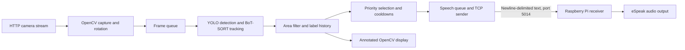

# SMART VIEW AI

**Computer vision for assistive audio guidance — university graduation project**

SMART VIEW AI investigates how object detection can be translated into selective spoken descriptions for people with visual impairments. Its central engineering focus is deciding **which object to announce, when to announce it, and how to avoid repeated alerts**, rather than reading every detection aloud.

The repository brings together the original Python processing application, a Raspberry Pi audio receiver, a graduation presentation, demonstration recordings, and prototype images. It documents a research and engineering prototype; the materials do not establish a validated navigation aid or independent mobility solution.

[Project presentation](smartview%20ai%20v4%20final.pptx) · [Demo 1](videos/demo_1.mp4) · [Demo 2](videos/demo_2.mp4) · [Processing code](main.py) · [Raspberry Pi code](raspberry_pi.py)

## Objectives

- Convert camera observations into concise object-and-direction phrases, such as “person on the right.”
- Reduce competing announcements using semantic priority classes and bounding-box area filtering.
- Use tracking IDs and temporal label accumulation to suppress repeated announcements.
- Separate vision processing from speech playback through a local-network Raspberry Pi audio node.
- Develop a Smart Cane obstacle-alert prototype alongside the vision application, and explore currency recognition as an experimental extension.

## Implementation status

| Component | Status and evidence |
| --- | --- |
| General object detection and tracking | Implemented in `main.py`; a supplied screenshot shows person/chair labels, IDs, zones, and area filtering. |
| Priority selection and speech suppression | Implemented in source; no comparative user study or quantitative reduction in alerts is provided. |
| Raspberry Pi audio delivery | TCP sender and eSpeak receiver are implemented; no controlled end-to-end hardware validation report is included. |
| Money detection | Experimental. A mode and model-loading path exist, and an image shows a banknote detection. Custom weights, training data, and evaluation results are absent. |
| Smart Cane | Implemented, tested, and demonstrated obstacle-detection and alert prototype, as confirmed by the project team. A supplied photograph documents the physical prototype; quantitative test records and wiring are not included. |
| Cane sensor and alert components | Exact ultrasonic sensor, vibration motor, and buzzer models, specifications, wiring, and individual operating behavior cannot be verified from the available repository materials. |
| Mobile deployment, reading, smart glasses, haptics, offline operation | Future directions in the presentation. A phone interface appears in the videos, but its source and integration are not included in the supplied Python implementation. |

## System architecture



The processing computer captures an HTTP video stream and rotates each frame 90° clockwise. Separate camera, inference, and network threads communicate through queues of size one. The camera replaces queued frames when necessary, while inference processes every third frame it dequeues. These choices limit queued work; they do not establish a guaranteed frame rate or latency.

PyTorch selects CUDA when available and otherwise uses the CPU. The graphical loop displays annotated results and accepts mode-switching keys. Vision inference runs on the processing computer; `raspberry_pi.py` performs speech playback rather than YOLO inference.

## Key technical contributions

These are application-level integration and decision-policy contributions built on existing YOLO and BoT-SORT components. The repository does not claim a new detector or tracking algorithm.

### 1. Priority Classes

The code selects one eligible target per inference result using the following dictionary:

| Priority | Labels configured in the source |
| --- | --- |
| 1 | `person`, `car`, `motorcycle`, `bus`, `truck`, `bicycle`, `stop sign`, `traffic light`, `fire hydrant` |
| 2 | `chair`, `couch`, `bed`, `dining table`, `bench`, `door` |
| 3 | Any other detected label |

Lower numbers take precedence; equal-priority candidates are compared by bounding-box area, favoring the larger box. Money mode assigns all candidates priority 1. Priority labels are configuration entries: adding `door` to the dictionary does not make the loaded general model capable of detecting doors.

### 2. Object Filtering

Both modes use a confidence threshold of **0.60**. General mode uses `imgsz=160` and an area threshold of **18,000 pixels²**; money mode uses `imgsz=480` and **4,000 pixels²**. These are configured parameters, not measured performance results. Area is computed from box coordinates in the captured frame.

Boxes below the area threshold remain visible with a white outline and a “Too Far” label but are excluded from spoken-target selection. This is an image-area heuristic: apparent size depends on object dimensions, framing, and camera geometry. It is **not a calibrated distance measurement** and is separate from ultrasonic ranging.

### 3. ID Tracking and temporal speech control

Ultralytics tracking uses `persist=True` with `botsort.yaml`. The application maintains label counts per tracking ID and selects the most frequently observed label for that ID. An object becomes eligible after that label accumulates at least **five qualifying observations**; these need not be consecutive frames.

Once a phrase is enqueued, the track is marked as spoken. A class-level cooldown suppresses the same label for **five seconds**, while a global speech interval of **3.5 seconds** separates enqueued phrases. Track history expires after five seconds without a qualifying observation, and application history is cleared on a mode change. These mechanisms aim to reduce repetition; tracking errors and reidentification can still lead to repeated alerts. Enqueueing a phrase does not confirm successful delivery or audible playback.

## YOLO detection and audio guidance

General mode loads `yolov8x.pt` using Ultralytics. YOLO produces object boxes and class labels, while the tracker associates detections across frames. The application compares each box center with the image midpoint to generate “left” or “right.” This is a two-zone image description, not route planning, depth estimation, or collision prediction.

The network thread sends the selected phrase followed by a newline. On the Raspberry Pi, the receiver accumulates partial TCP packets, extracts complete lines, and invokes:

```text
espeak -s 150 -g 10 <received phrase>
```

The Pi listens on all interfaces on TCP port `5014` and handles one client at a time. Speech execution is synchronous. The client makes one initial connection attempt and does not automatically reconnect. The protocol has no authentication, encryption, delivery acknowledgement, or audio-completion feedback; use a trusted local network.

## Observed results

### General detection screenshot


The supplied screenshot shows a person and chair with tracking IDs, accumulated label counts, the center line, and a white “Too Far” box. It supports the presence of visual detection and filtering output for this scene. Its instantaneous FPS overlay is not a benchmark, average throughput, or end-to-end latency measurement. A still image cannot establish ID stability over time, speech quality, or safe navigation.

### Experimental Money Detection


Experimental Money Detection — Custom YOLO Model Using Roboflow

As part of the SMART VIEW AI project, we developed and tested an experimental money detection feature using a custom YOLO-based object detection model and a dataset prepared through Roboflow.

The objective was to explore whether the system could recognize banknotes and provide audio feedback to visually impaired users.

1. Custom Dataset Collection

To develop this feature, we created a custom image dataset containing four currency categories.

* Dataset Size: Approximately 400 images in total.
* Number of Classes: 4 currency categories.
* Images per Class: Approximately 100 images.
* Dataset Platform: Roboflow.
* Image Diversity: Banknotes were photographed from multiple viewing angles, orientations, and positions.
* Background Variation: Different backgrounds were used to introduce visual diversity and help the model learn under varying conditions.

Rather than relying exclusively on a pretrained general-purpose detection model, this experiment involved collecting task-specific images and preparing a dedicated dataset for currency recognition.

2. Custom YOLO Model Training

The collected dataset was managed using Roboflow and used to train a custom YOLO-based object detection model.

The experiment involved:

* Collecting and organizing images into four categories.
* Preparing a custom dataset for object detection.
* Training a task-specific detection model.
* Testing the model’s ability to identify banknotes.
* Observing recognition limitations under different visual conditions.

This process provided practical experience in custom dataset development, computer vision workflows, and object detection model training.

3. Integration into SMART VIEW AI

An experimental money detection mode was implemented within the SMART VIEW AI application.

The source code attempts to load custom YOLO model weights from best.pt when the money detection mode is selected.

The project demonstration includes an example of the application operating in money detection mode, with a bounding box around a US twenty-dollar banknote.

However, the current GitHub repository does not include the trained model weights, original dataset, training configuration, complete class list, or independent evaluation results.

If best.pt cannot be loaded, the application prints an error and falls back to the general object detection model.

Therefore, selecting money detection mode does not necessarily confirm that the custom currency recognition model is active.

4. Audio Feedback

The experimental money detection mode uses the application’s existing object announcement mechanism.

Detected objects are processed through the same class-and-direction speech template used in the general detection mode.

A separate currency-specific speech formatting system was not implemented.

5. Experimental Results and Limitations

Although the custom model was trained and the feature was explored during development, its performance was not sufficiently reliable for inclusion as a validated component of the final assistive system.

The available demonstration does not establish reliable recognition across different denominations, currencies, lighting conditions, backgrounds, or viewing angles.

Additionally, verified quantitative evaluation metrics, such as precision, recall, and mean Average Precision (mAP), are not available in this repository.

For these reasons, money detection remained an experimental feature rather than a fully deployed currency recognition system.

6. Technical Experience Gained

This experiment provided hands-on experience in:

* Custom dataset collection and organization.
* Dataset management using Roboflow.
* Image diversity and background variation.
* Training custom YOLO-based object detection models.
* Integrating experimental AI models into an existing application.
* Understanding the importance of model evaluation and real-world reliability.

Although money detection was not retained as a validated feature of the final system, the experiment contributed to the project’s exploration of task-specific computer vision applications.

## Smart cane prototype and ultrasonic sensing


The Smart Cane is an **implemented and tested prototype**, not merely a proposed feature. The project team confirms that it was successfully built, tested, and demonstrated, detecting obstacles and providing alerts in practical use. The supplied photograph documents the physical prototype. This qualitative team report does not establish detection range, accuracy, reliability, or validation across environments.

An ultrasonic sensor estimates range from an emitted pulse's round-trip echo time. This is distinct from the vision application's bounding-box area heuristic. The available presentation text, source code, and prototype image do not identify exact ultrasonic sensor, vibration motor, or buzzer models or specifications. Sensor firmware, wiring, trigger distances, and the individual vibration/buzzer alert behavior are not documented, so no component model or operating threshold is asserted here.

Neither supplied Python application reads GPIO or ultrasonic measurements. The implemented cane should therefore be distinguished from its connection to the vision/audio pipeline: that connection is not established by the available code. The team's confirmation supports the cane's practical prototype status without implying that the complete combined system has undergone controlled hardware validation.

## Project Demonstration

- [Watch Demo 1](videos/demo_1.mp4)
- [Watch Demo 2](videos/demo_2.mp4)

Both original MP4 files are preserved. Sampled frames show a phone interface and camera imagery; interface controls alone do not verify working reading, currency recognition, offline inference, or integration with the supplied Python programs. These recordings are qualitative project materials rather than controlled experiments.

## Live Demonstration & Results

SMART VIEW AI was successfully demonstrated during the final graduation project evaluation at Jinan University.

During the live demonstration, the system successfully performed its core functions:

* Real-Time Object Detection: Identified objects and people using the YOLO-based computer vision pipeline.
* Object Tracking: Tracked detected objects to support consistent identification.
* Intelligent Prioritization: Applied filtering and priority rules to determine which detected objects should be announced.
* Audio Guidance: Generated spoken feedback describing detected objects and their relative positions.
* System Integration: Demonstrated the operation of the computer vision pipeline and its audio feedback components.

The live demonstration confirmed that the core system components could operate together successfully in a controlled academic environment.

Academic Evaluation

Final Graduation Project Grade: 92/100

The project was evaluated as part of the Bachelor’s degree in Computer Science at Jinan University.

Evaluation Scope

Although the live demonstration was successful, it does not establish validated performance in uncontrolled real-world environments.

Further testing would be required to evaluate detection accuracy, system latency, navigation reliability, and usability with visually impaired individuals.

## Technologies and dependencies

| Technology | Use |
| --- | --- |
| Python | Processing application and Pi audio receiver |
| OpenCV (`opencv-python`) | HTTP camera capture, rotation, annotation, graphical display |
| PyTorch (`torch`) | CPU/CUDA inference support |
| Ultralytics (`ultralytics`) | YOLO model loading and tracking API |
| BoT-SORT | Tracking through Ultralytics' `botsort.yaml` configuration |
| TCP sockets, threading, queues | Standard-library networking and concurrency |
| Raspberry Pi and eSpeak | Remote text-to-speech playback |
| Thonny | Development/run environment for the Pi application; not a runtime dependency |
| Roboflow | Custom currency-model development tool reported in the presentation; training artifacts are not included |

The third-party Python imports are listed in [requirements.txt](requirements.txt). The Pi receiver uses only `socket` and `subprocess` from the standard library, plus the external eSpeak executable. Original package and Python versions were not supplied, so dependencies are unpinned. Some Ultralytics versions may require additional tracking dependencies at runtime.

## Installation and operation

### Processing computer

Use a Python version supported by the installed PyTorch, Ultralytics, and OpenCV releases. A graphical desktop is required for `cv2.imshow`.

```bash
git clone https://github.com/omarsaadeh/SMART-VIEW-AI.git
cd SMART-VIEW-AI
python3 -m venv .venv
source .venv/bin/activate
python -m pip install -r requirements.txt
```

On Windows, activate with `.venv\Scripts\activate`. For CUDA, follow the official PyTorch installation instructions for a build compatible with the local GPU and drivers. CPU fallback is implemented, but throughput is hardware-dependent.

Run from the repository root. Supply `yolov8x.pt` there, or allow Ultralytics to download it. To reproduce the currency experiment, obtain the original custom `best.pt` separately; a general YOLO model is not a replacement for those weights. Model files are excluded by `.gitignore`.

### Raspberry Pi audio node

On Raspberry Pi OS, install eSpeak and configure a working audio output:

```bash
sudo apt update
sudo apt install espeak
python3 raspberry_pi.py
```

Alternatively, open `raspberry_pi.py` in Thonny and run it on the Pi. The computer's vision dependencies are not required for this audio-only script.

### Network settings and launch order

The original source values are preserved:

| Setting | Current value |
| --- | --- |
| Raspberry Pi address in `main.py` | `172.20.10.8` |
| TCP port in both scripts | `5014` |
| HTTP camera URL in `main.py` | `http://172.20.10.2:8080/video` |

For a different deployment, these source settings must match the actual devices; the programs do not load environment variables or command-line configuration. No source settings were changed for this portfolio update.

1. Start an HTTP camera stream reachable by the processing computer.
2. Start the Pi audio receiver before the processing application.
3. Activate the processing environment and run `python main.py` from the repository root.
4. Focus the OpenCV window: `1` selects general detection, `2` selects experimental money mode, and `q` exits when the display loop is receiving frames.
5. Stop the Pi receiver with `Ctrl+C`.

## Limitations and research directions

Limitations and Future Work

SMART VIEW AI was developed as an academic proof-of-concept to explore real-time object detection, intelligent prioritization, and audio-based assistance for visually impaired individuals.

The project successfully demonstrates the integration of computer vision, object tracking, decision-making logic, and Raspberry Pi-based audio feedback at the prototype level.

However, comprehensive quantitative evaluation, including detection accuracy, processing latency, tracking performance, and user-navigation testing, remains an important area for future development.

Future improvements include:

* Conducting systematic performance evaluations under different lighting and environmental conditions.
* Optimizing real-time processing and reducing unnecessary audio announcements.
* Further developing and evaluating the custom currency detection model.
* Expanding the integration between the vision system and the smart cane.
* Investigating mobile deployment, smart glasses, and fully offline operation.

The current implementation is intended for academic research and experimentation rather than use as a certified mobility or safety device.

## Team and verified contributions

The presentation identifies the team and supervisor. The following full names, roles, and individual contributions were subsequently confirmed by the project team:

| Person | Verified attribution |
| --- | --- |
| Omar Ahmad Saadeh — Team Leader | Led and coordinated the team; responsible for project planning and technical decision-making; worked on main software development and AI system integration. |
| Ali Abdelwahed | Developed and assembled the Smart Cane; assisted with Raspberry Pi software development and integration. |
| Wael Saadeh | Assisted with project hardware development and integration. |
| Dr. Rami Sefarjaleni | Project supervisor |


## Repository materials and evidence

| Material | Reference |
| --- | --- |
| Original processing application | [main.py](main.py) |
| Original Raspberry Pi receiver | [raspberry_pi.py](raspberry_pi.py) |
| Python dependencies | [requirements.txt](requirements.txt) |
| Graduation presentation, 12 slides | [smartview ai v4 final.pptx](smartview%20ai%20v4%20final.pptx) |
| General detection result | [Original image](WhatsApp%20Image%202026-11-12%20at%2010.41.18%20AM.jpeg) |
| Currency experiment | [Original image](WhatsApp%20Image%202026-11-12%20at%2011.06.00%20AM.jpeg) |
| Cane prototype | [Original image](WhatsApp%20Image%202026-11-12%20at%2011.11.37%20AM.jpeg) |
| Demonstration recordings | [Demo 1](videos/demo_1.mp4), [Demo 2](videos/demo_2.mp4) |

This README uses the source for software implementation details, readable slide text for project intent and attribution, supplied images for scene-specific observations, and explicit project-team confirmation for individual contributions and the Smart Cane’s built/tested/demonstrated status. Presentation aspirations are distinguished from code-backed functionality. The portfolio update preserves all original source and media files.

Academic Prototype Disclaimer
SMART VIEW AI was developed as an academic graduation project to explore the application of Artificial Intelligence and Computer Vision in assistive technologies for visually impaired individuals.
The system is a proof-of-concept prototype intended for educational and research demonstration purposes.
Although the prototype was successfully demonstrated, it has not undergone the comprehensive security, reliability, and safety validation required for real-world deployment.
The project is not intended to replace certified mobility aids or professional assistance.
